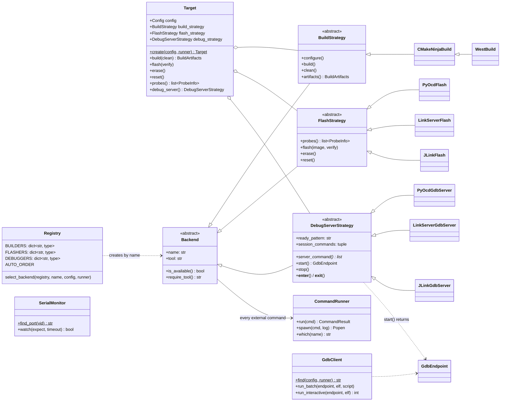

# `scripts/operations.py`: build, flash, debug, monitor

This is the single-file tool that builds firmware against the MCUXpresso SDK, programs it
into the FRDM-MCXN947, runs GDB and watches the debug UART. Host setup is described in
[setup_host.md](setup_host.md).

Run it from the `xAT/` root with the system Python. No venv activation is needed:

```sh
python3 scripts/operations.py <command> [options]
```

## Commands

| Command | What it does |
|---|---|
| `doctor` | Checks the SDK, toolchain, cmake/ninja versions, GDB, pyOCD and its target pack, the probe (`lsusb`) and the VCOM port, and lists which backends are installed. |
| `build [--clean] [--builder cmake\|west]` | Configures (CMake + Ninja, out of tree) and builds the app into `build/<app>/<config>/`, then prints `arm-none-eabi-size`. |
| `flash [--flasher …] [--probe UID] [--no-verify] [--erase]` | Programs the ELF, reads it back to verify, then resets the MCU. `--erase` only erases the chip. |
| `debug [--debugger …] [--port 3333] [--gdb PATH] [--batch FILE]` | Starts the GDB server, connects GDB (reset and halted), then either gives an interactive `(gdb)` prompt or runs `FILE` in batch mode. The server is always stopped afterwards. |
| `monitor [--port DEV] [--baud N] [--expect TEXT] [--timeout S] [--no-reset]` | Opens the UART, resets the MCU (unless `--no-reset`) and prints lines. With `--expect` it exits 0 when the text arrives, or 3 on timeout (default 10 s). |
| `run [--clean] [--flasher …] [--expect TEXT] [--timeout S]` | Smoke test: build, open UART, flash and reset, wait for `boot OK`. |

Global options go **before** the command: `--config debug|release`,
`--app src/hello_uart`, `--sdk`, `--armgcc`, `--board`, `--core`, `-v` (shows the output
of every tool).

Examples:

```sh
python3 scripts/operations.py build --clean
python3 scripts/operations.py --config release build
python3 scripts/operations.py flash --flasher linkserver
python3 scripts/operations.py monitor --expect "boot OK" --timeout 10
python3 scripts/operations.py debug                                   # interactive (gdb)
python3 scripts/operations.py debug --batch src/hello_uart/gdb/smoke_test.gdb
python3 scripts/operations.py run
```

### Exit codes

| Code | Meaning |
|---|---|
| 0 | success |
| 1 | failure (tool missing, command failed, verify failed, …) |
| 2 | invalid command line (argparse) |
| 3 | `monitor`/`run`: expected text not received before the timeout |

### Backends

| Concern | Names | Default |
|---|---|---|
| build | `cmake` (CMake + Ninja), `west` | `cmake` |
| flash | `pyocd`, `linkserver`, `jlink` | `auto` |
| debug server | `pyocd`, `linkserver`, `jlink` | `auto` |

`auto` picks the first backend whose tool is installed, in the order
pyocd → linkserver → jlink, then any other registered backend.

| Backend | Verified on this host |
|---|---|
| pyOCD 0.45.1 | yes: flash, verify, reset, GDB batch and interactive |
| LinkServer 26.9.130 | yes: flash, verify, reset, GDB batch and interactive |
| J-Link | no (needs a J-Link probe); unit-tested only |
| west | no (not installed); unit-tested only |

Notes per backend:

- **pyOCD.** Verify reads back each ELF `PT_LOAD` segment with `commander compare`. The
  `.bin` cannot be used for this, because it zero-fills the gap between `.interrupts`
  (ends at `0x2b0`) and `.text` (starts at `0x400`), and that gap is never programmed.
- **LinkServer.** GDB must run `load` after connecting, otherwise `monitor reset` fails
  ("No image address available"). The LinkServer strategy does this automatically.

### Configuration

Defaults live in the frozen dataclass `Defaults` at the top of `operations.py`. They are
overridden first by environment variables and then by CLI options:

| Variable | Overrides |
|---|---|
| `XAT_SDK_ROOT` | SDK root (default `<workspace>/mcuxsdk`) |
| `ARMGCC_DIR` | toolchain root (default newest `<workspace>/tools/arm-gnu-toolchain-*-arm-none-eabi`) |
| `XAT_BOARD`, `XAT_CORE` | board / core id |
| `XAT_BUILDER`, `XAT_FLASHER`, `XAT_DEBUGGER` | backend names |
| `XAT_PROBE` | probe unique id / serial |
| `XAT_GDB` | GDB executable |
| `XAT_PYOCD_TARGET` | pyOCD target (default `mcxn947vdf`) |
| `XAT_SERIAL_PORT` | UART device (default: auto-detect the MCU-Link VCOM, USB VID `0x1fc9`) |
| `XAT_LINKSERVER_DIR` | extra directory to search for `LinkServer` |

## Design

The file is organised in this order: defaults/config, errors, `CommandRunner`, value
objects, strategy interfaces, strategy implementations, registry, `Target`,
`SerialMonitor`, `GdbClient`, CLI, `main()`.



- **Context.** `Target` holds the resolved `Config` and one strategy per concern. It only
  delegates; it never runs a tool (a unit test checks that).
- **Strategies.** Each backend is one small class. Common behaviour lives in the base
  classes. `DebugServerStrategy` implements `start`/`stop` once (spawn, wait for
  `ready_pattern` in the server log, terminate and then kill). Subclasses provide
  `server_command()`, `ready_pattern` and `session_commands`, the GDB commands that reset
  and halt the MCU for that server. Thanks to `session_commands`, GDB scripts work with
  every backend.
- **External commands.** All of them go through `CommandRunner`, which logs the exact
  command line and raises `CommandError` (with stdout/stderr) on a non-zero exit. The unit
  tests inject a fake runner, so they need no hardware.
- **Cleanup.** The debug server is used as a context manager. SIGTERM is turned into
  `SystemExit`, so the server is stopped even when the tool is killed. During interactive
  GDB, Ctrl-C only interrupts the target.
- **Optional dependencies.** `pyserial` is imported only by `SerialMonitor`. pyOCD,
  LinkServer, J-Link, CMake and GDB are used through their CLIs, so `--help` and `doctor`
  run with only the standard library.

### Adding a backend (Open/Closed)

A new backend is **one class plus one registry entry**. `Target`, `select_backend` and the
CLI stay unchanged: the `--flasher`/`--debugger` choices are built from the registry keys,
and `auto` tries backends that are not in `AUTO_ORDER` after the listed ones. Example:

```python
class OpenOcdFlash(FlashStrategy):
    name = "openocd"
    tool = "openocd"

    def probes(self) -> list[ProbeInfo]:
        return []

    def flash(self, image: BuildArtifacts, verify: bool = True) -> None:
        self.require_tool()
        args = ["-f", "board.cfg", "-c", f"program {image.elf} {'verify' if verify else ''} exit"]
        self.runner.run(["openocd", *args])

    def erase(self) -> None: ...

    def reset(self) -> None:
        self.runner.run(["openocd", "-f", "board.cfg", "-c", "init; reset run; exit"])


FLASHERS[OpenOcdFlash.name] = OpenOcdFlash   # the only other line needed
```

`test_registry_open_for_new_backend` in `tests/scripts/test_operations.py` registers such
a class and checks that `auto`, the CLI parser and `Target.flash()` all pick it up.

## Smoke-test firmware and GDB script

- `src/hello_uart/` is built out of tree with
  `PROJECT_BOARD_PORT_PATH=examples/_boards/frdmmcxn947/demo_apps/hello_world`. This reuses
  the SDK's `hardware_init.c` (`BOARD_InitHardware`), `pin_mux.c`, `app.h`, `board.c` and
  `clock_config.c`, so **no SDK file is copied**.
- The debug build adds `-g3` (the SDK debug config only has `-O0 -g`). `main.c` is compiled
  with `-std=c11`; SDK sources keep the vendor `-std=gnu99`.
- `src/hello_uart/gdb/smoke_test.gdb`: runs to `main`, reads `g_tickCount`, steps, resumes
  until one tick has been printed (`g_tickCount >= 1`, otherwise `quit 1`), then detaches.

## Tests

```sh
.venv/bin/python -m pytest tests/scripts
```

47 tests. They cover every strategy class, `Target`, the registry and `auto` selection,
`Config` layering, `CommandRunner`, `SerialMonitor`, `GdbClient`, the ELF segment reader
and the CLI. They need no hardware and no external tools.
